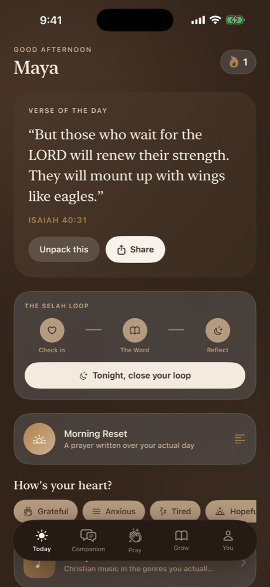
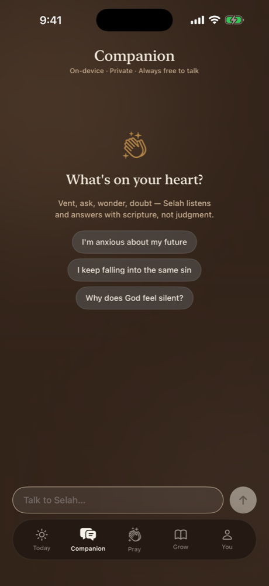
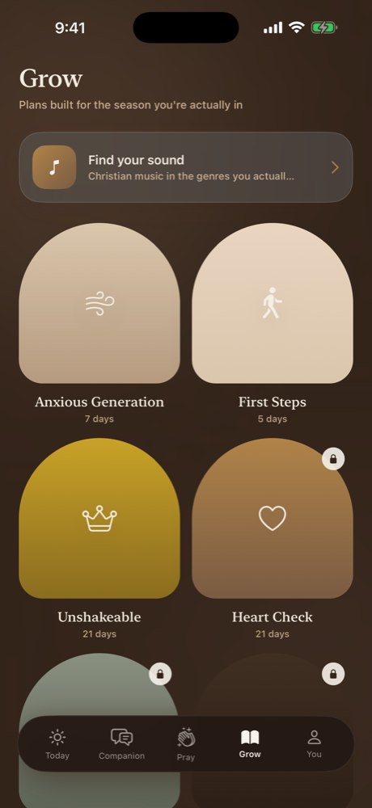
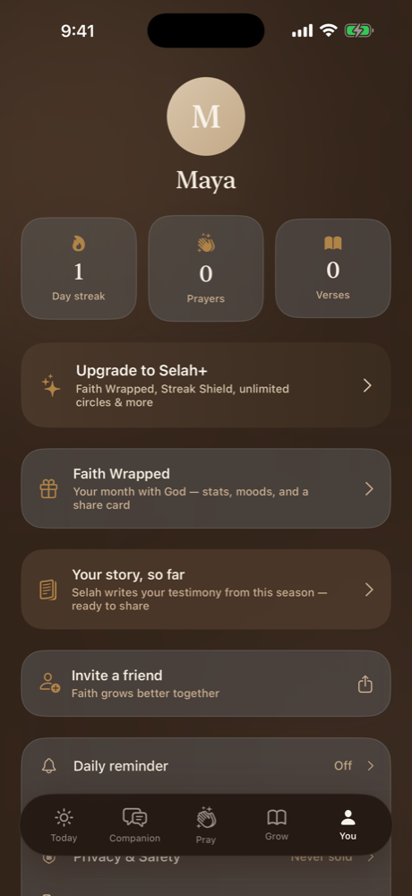
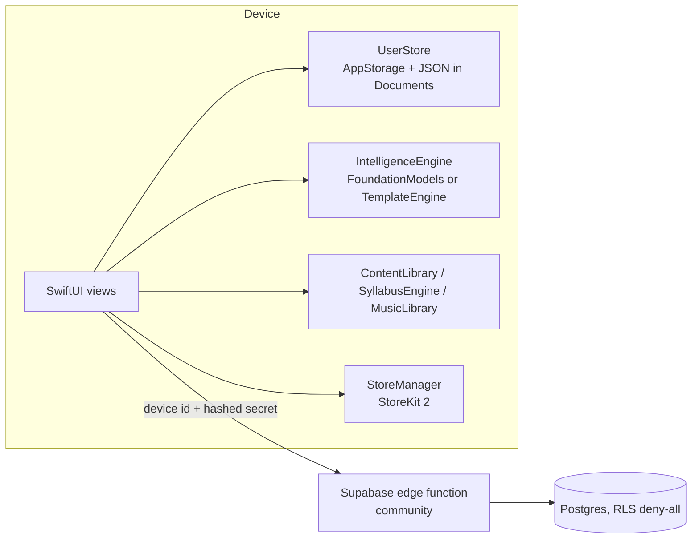

# Selah

A private, on-device faith companion for iPhone, built for Christians aged 18–28: daily scripture, a reflective AI companion, prayer journaling, anonymous community prayer and short devotional plans keyed to how you feel today.

<p align="center">
  
</p>

<p align="center">
  
  
  
  
</p>

## Why

Most faith apps either feel like church bulletins or send your most personal data to an ad network. Selah's premise is "faith, at your pace": a quiet space that runs its AI on the phone, needs no account, and keeps journals and prayers on the device unless you choose to share them anonymously.

## Features

- **Today:** verse of the day, a mood check-in, and the Selah Loop (check in → read the Word → evening reflection) with its own streak.
- **Companion:** a chat that answers with scripture. It uses Apple's on-device Foundation Models on iOS 26 and falls back to a curated template engine on older devices. A crisis check runs before any model and surfaces the 988 lifeline.
- **Morning Reset / Evening Wind-Down:** written liturgies personalized with your name, mood, open prayers and (optionally) today's calendar.
- **Answered Prayer Vault:** follow-ups after five days turn answered prayers into "stones" that resurface on hard days.
- **Syllabus:** eight curated seven-day devotional arcs, one per mood, personalized at generation.
- **Verse memorization** with first-letter recall and spaced repetition.
- **Selah Sound:** a daily five-song soundtrack across eight genres, matched to your mood, with Apple Music and Spotify search links.
- **Community (anonymous by default):** prayer wall, "He answered" testimonies, private Circles with invite codes, public groups, a Prayer Relay queue, and The Commons chat with daily rotating handles. Block, report and auto-hide are built in.
- **Temptation SOS,** voice prayers via on-device speech transcription, and short voice blessings shared over iMessage.
- **Share cards** rendered with `ImageRenderer`, and a monthly **Faith Wrapped**.
- **Selah+** (StoreKit 2, $9.99/mo or $59.99/yr with a 14-day trial): Wrapped, Streak Shield, unlimited circles, evening liturgy.
- Dark "espresso" and light "cream" themes.

## How it works



- Everything personal (journal, vault, moods, streaks) is local. Device identity lives in the Keychain; there is no login.
- All community reads and writes go through one Supabase edge function (`community`). Tables are RLS deny-all, and the function handles word filtering, rate limits and report thresholds. The edge function and migrations are not part of this repository; without a backend configured, the community features show an offline state and the rest of the app works.

## Tech stack

Swift 5, SwiftUI, iOS 17+ (on-device AI on iOS 26), FoundationModels, Speech, EventKit, StoreKit 2, UserNotifications, Supabase edge functions.

## Open and build in Xcode

1. Open `Selah.xcodeproj` in Xcode (Xcode 26 recommended; FoundationModels code is behind `#if canImport`, so older SDKs build with the template engine only).
2. Optional, to enable community features: copy `Config/Secrets.example.xcconfig` to `Config/Secrets.xcconfig` and fill in `SELAH_SUPABASE_HOST` and `SELAH_SUPABASE_ANON_KEY`. `Config/App.xcconfig` includes it if present; `Support/Info.plist` passes the values to the app.
3. Select the **Selah** target → Signing & Capabilities and choose your own team (left empty in the repo). Change the bundle identifier for device builds.
4. Pick an iPhone simulator and press **Run** (⌘R).
5. For local purchase testing, set Scheme → Run → Options → StoreKit Configuration to `SelahProducts.storekit`.

Command line:

```sh
xcodebuild -project Selah.xcodeproj -scheme Selah -sdk iphonesimulator \
  -destination 'platform=iOS Simulator,name=iPhone 17' CODE_SIGNING_ALLOWED=NO build
```

In Debug builds, setting the `selah.debugTab` user default (`today`, `chat`, `pray`, `grow`, `you`) opens a specific tab at launch.

## Project structure

```
Selah/
  SelahApp.swift           entry, appearance, push registration
  Models.swift             UserStore, moods, prayers, journal
  IntelligenceEngine.swift on-device companion + template fallback + crisis check
  ContentLibrary.swift     verses, devotionals, challenges, reading plans
  SyllabusEngine.swift     mood-based 7-day plans
  MusicLibrary.swift       genre/mood song catalog
  Community.swift          edge-function client, Keychain device identity
  StoreManager.swift       StoreKit 2
  NotificationService.swift reminders and streak guard
  Views/                   Today, Companion, Pray, Grow, Profile, paywall, share cards, ...
Config/                    App.xcconfig + Secrets.example.xcconfig
Support/Info.plist         backend keys injected from xcconfig
SelahLegal/                static privacy policy page
BrandKit/                  icon, wordmarks, banner, brand book
docs/screenshots/          simulator captures
```

## Status

Version 1.0 was uploaded to TestFlight in July 2026. It has not been released on the App Store: subscription products still need to be set up in App Store Connect, and the community backend is currently paused.

---

Built by [Ian Royes](https://github.com/ianroyes-sys)
